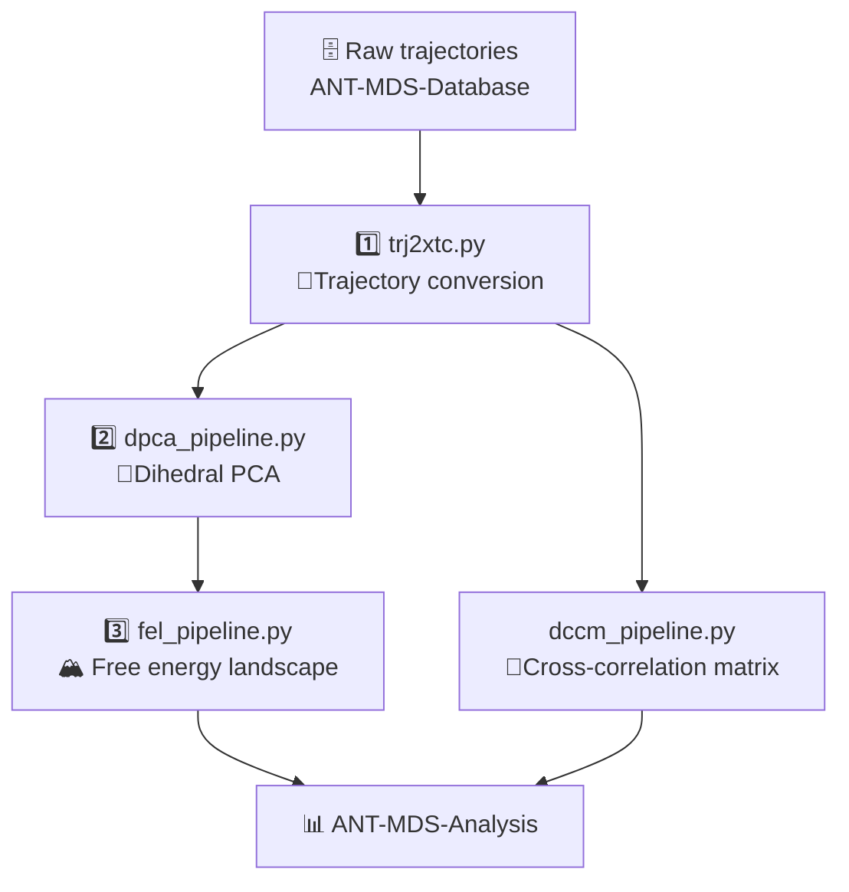

<div align="center">

# 🧬 ANT-MDS-Pipelines

### Trajectory processing and analysis pipelines for the ANT(3″)-Ia computational biology study


--Ia-2E8B57?style=flat-square)

<br>

**dPCA** · **FEL** · **DCCM** · **Trajectory format conversion**

</div>

---

## Overview

This repository holds the core pipelines used to process and analyse molecular dynamics (MD) trajectories for the **ANT(3″)-Ia** aminoglycoside-modifying enzyme study. It brings together the analyses needed to move from raw trajectories to interpretable descriptions of conformational dynamics.

## What's Inside

| Pipeline | Purpose |
|---|---|
| **dPCA** | Dihedral principal component analysis of backbone conformational motion |
| **FEL** | Free energy landscapes projected onto principal components |
| **DCCM** | Dynamic cross-correlation matrices showing correlated residue motions |
| **Format conversion** | Converting trajectories between formats for downstream tools |

## Repository Structure

This project is part of a **three-repository ecosystem**:

```
ANT-MDS
├── 🔧 ANT-MDS-Pipelines   ← you are here (core pipelines)
├── 📊 ANT-MDS-Analysis    (downstream analysis scripts and results)
└── 🗄️ ANT-MDS-Database    (trajectory data)
```

| Repository | Description | Visibility |
|---|---|---|
| 🔧 **ANT-MDS-Pipelines** | Core processing and analysis pipelines (this repo) | Public |
| 📊 [**ANT-MDS-Analysis**](https://github.com/Menzisk/ANT-MDS-Analysis) | Downstream analysis scripts and results | Public |
| 🗄️ [**ANT-MDS-Database**](https://github.com/Menzisk/ANT-MDS-Database) | Trajectory data | Public |

## 🔄 Workflow

Every analysis starts with trajectory conversion. From there the workflow splits into two independent branches: **dPCA → FEL**, and **DCCM** on its own.



| Step | Script | Input | Notes |
|---|---|---|---|
| 1 | [`trj2xtc.py`](https://github.com/Menzisk/ANT-MDS-Pipelines/blob/main/trj2xtc.py) | Raw trajectories | Required first step for all analyses |
| 2 | [`dpca_pipeline.py`](https://github.com/Menzisk/ANT-MDS-Pipelines/blob/main/dpca_pipeline.py) | Converted trajectory | Feeds step 3 |
| 3 | [`fel_pipeline.py`](https://github.com/Menzisk/ANT-MDS-Pipelines/blob/main/fel_pipeline.py) | dPCA output | Runs after dPCA |
| — | [`dccm_pipeline.py`](https://github.com/Menzisk/ANT-MDS-Pipelines/blob/main/dccm_pipeline.py) | Converted trajectory | Independent of steps 2 and 3; runs straight after step 1 |

## Getting Started

```bash
git clone https://github.com/Menzisk/ANT-MDS-Pipelines.git

```

> Requires **Python 3.10+**.

## Citation

Manuscript in preparation. If you use this work, please cite:

> Sikakane M. *et al.*, 2026.

## Author

**Menzi Sikakane**
[](https://github.com/Menzisk)
[](https://orcid.org/0009-0005-2472-6548)

---

<div align="center">
<sub>Built for the ANT(3″)-Ia computational biology study 🧬</sub>
</div>
